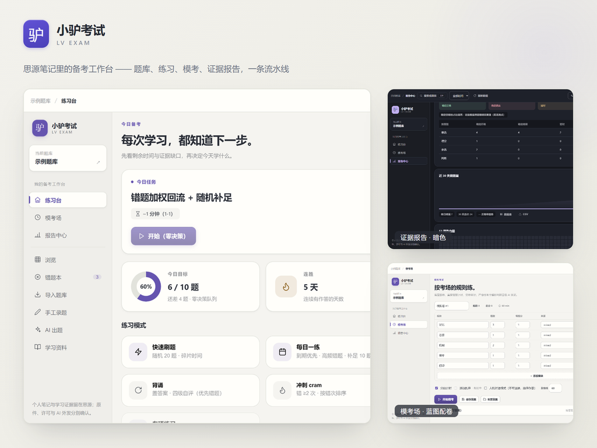
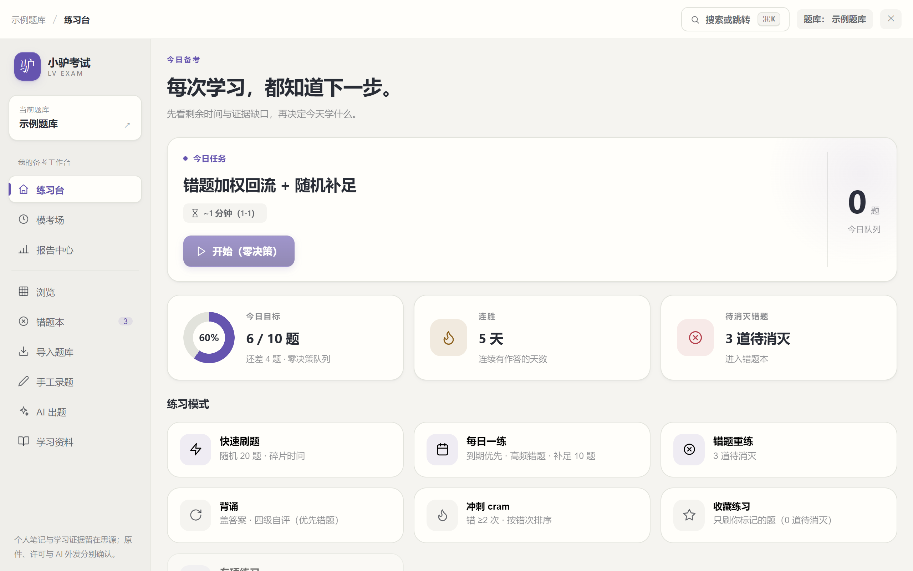
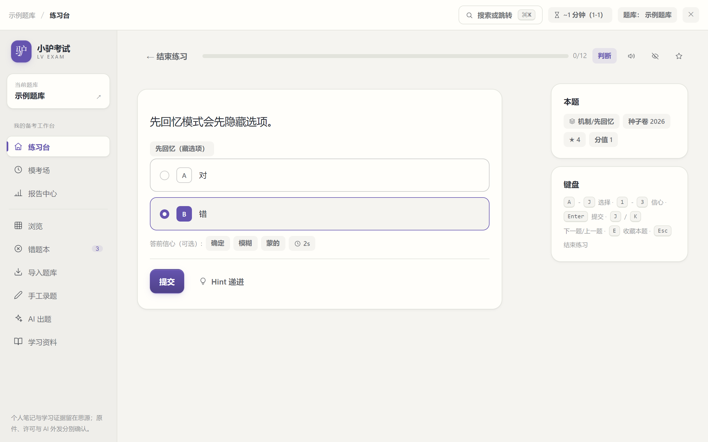
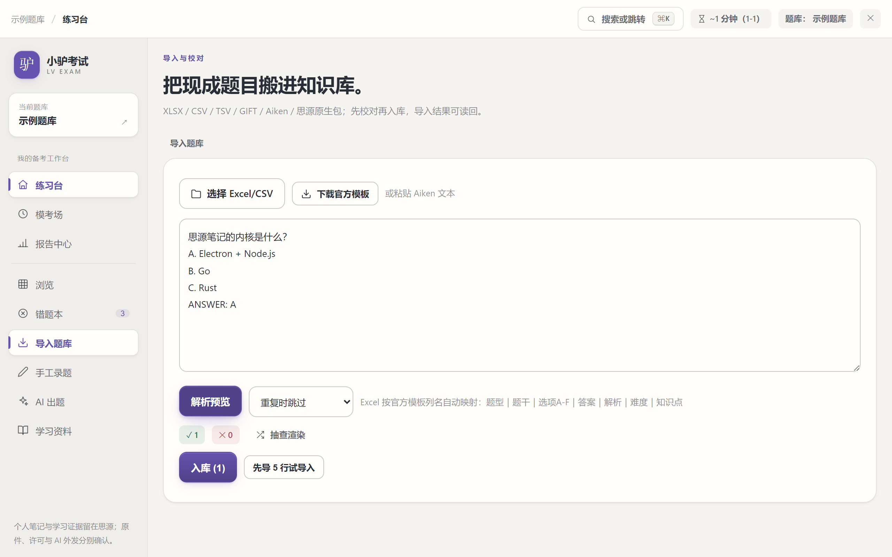
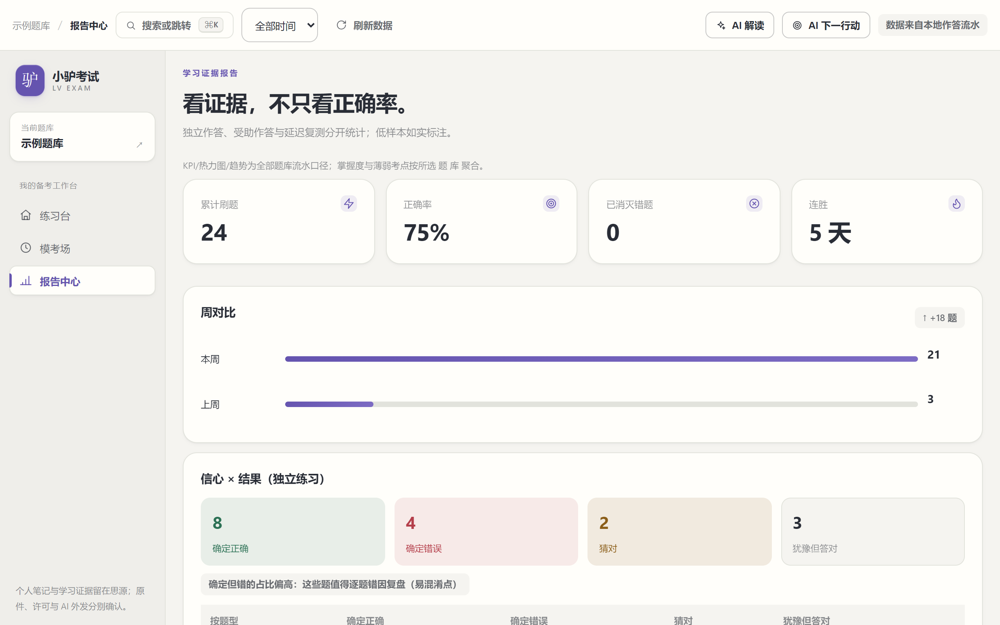
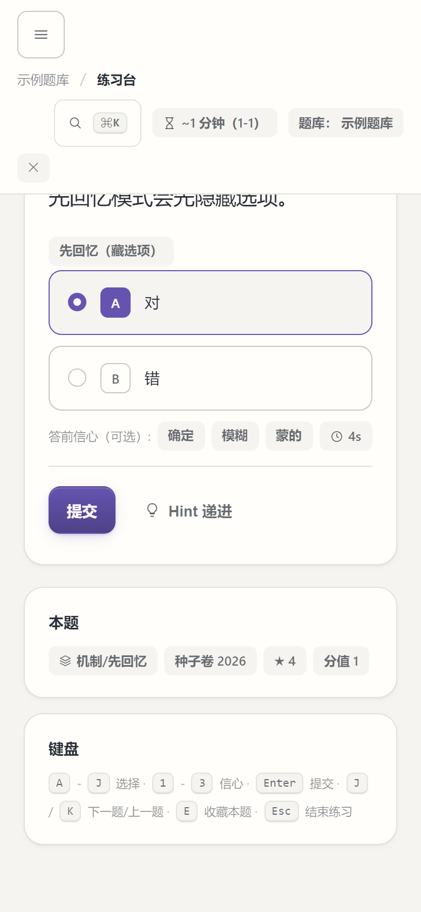

# 小驴考试（内测版）

> **内测说明：** 小驴考试仍处于内测阶段，功能和界面会持续调整，部分能力尚未完成真实思源环境或大题库验证。请先用自有或获准的小样例试用，并为重要资料保留备份。欢迎加入交流 QQ 群 **871707735** 反馈 Bug、提交需求和交流使用体验。

**思源笔记上的本地优先备考工作台：AI 辅助整理与复盘，学习过程和证据可追溯。**

小驴考试（内测版）面向使用思源笔记的自主备考者，把自己的题目、资料、作答与反思连接起来：看清还缺什么，选择下一步练习，再用独立作答与延迟复测检查理解，留下可复用的个人知识。

**用户资料 → 独立作答 → 复盘行动 → 复测 → 个人知识库**

[](https://github.com/ai68298100/siyuan-exam/releases)
[](https://github.com/ai68298100/siyuan-exam/actions/workflows/check.yml)
[](#开发)
[](https://github.com/siyuan-note/siyuan)
[](LICENSE)

[English](README.en-US.md) · [当前状态](docs/STATUS.md) · [交付说明](docs/DELIVERY.md) · [组件清单](docs/UI-COMPONENTS.md) · [贡献指南](CONTRIBUTING.md) · [安全报告](SECURITY.md) · [下载发行包](https://github.com/ai68298100/siyuan-exam/releases) · [查看 R54 UI 原型](design/prototype-r54/index.html) · [反馈问题](https://github.com/ai68298100/siyuan-exam/issues) · [参与讨论](https://github.com/ai68298100/siyuan-exam/discussions)

## 最新版本：v0.11.22（2026-10-24）

本版本为学习打卡自律连胜（streak）保号机制与连续天数算法体验升级版本。升级 `replayer.ts` 中的 `streak` 计算逻辑，当用户在今日尚未作答时，若昨日有作答打卡，自动延续并保留昨日的连续自律天数，彻底解决用户每天午夜过后打开插件看到连胜瞬间归零的体验痛点；只有在连续整整一天未学习时才判定断签归零。全套单测 177 个测试文件、1359 项单测 100% 全部通过。

## 上一版本：v0.11.21（2026-10-24）

本版本为题目散列计算与导入校验函数空指针深层防御升级版本。在 `answer.ts` 中 `questionHash` 增加对可选/空值选项（`options?: readonly string[]`）的强类型安全规整，杜绝任意未配置 options 的题目对象在计算去重散列值时抛出未捕获 TypeError；在 `pipeline.ts` 的 `validate` 中对单选、多选、选项折叠去重及题干泄漏核验全面引入 `Array.isArray(q.options)` 与空字符串兜底，让草稿题、残缺题或脏数据在导入和校验时安全返回明确错误原因，杜绝崩溃。全套单测 177 个测试文件、1359 项单测 100% 全部通过。

## 上一版本：v0.11.20（2026-10-24）

本版本为区分度分析空 stem 防御与多篇思源笔记批量提取试题重复统计修复升级版本。在 `calculateItemDiscrimination` 中对题目 `stem` 增加空值安全转换，修复在面对不完整草稿题或空块数据时直接访问 `.trim()` 抛出异常崩溃的隐患，并在 CSV 导出时增加安全空值防御；修复在批量从多篇思源笔记提取试题时 `duplicates` 漏计单篇内部自身重复数的缺陷。全套单测 177 个测试文件、1359 项单测 100% 全部通过。

## 上一版本：v0.11.19（2026-10-24）

本版本为 GIFT 判断题解析反馈导入缺陷修复与报告中心顶栏全景学情诊断直达升级版本。修复在 `gift.ts` 解析判断题时，若选项块带有反馈解析（如 `{TRUE#解析说明}` 或 `{FALSE#解析说明}`）因正则仅匹配纯关键字导致误判短答并最终解析为 null 报错的缺陷，重构解析正则并提取反馈填入试题解析，对齐 Moodle/学习通标准规范；在报告中心顶栏操作区常驻高对比主按钮【📊 全景学情报告】，支持一键导出带离线 CSS 与五维雷达的出版级 A4 学情报告。全套单测 177 个测试文件、1359 项单测 100% 全部通过。

## 上一版本：v0.11.18（2026-10-24）

本版本为模考考场移动端虚拟键盘防遮挡、多平台试题导出防御与语音朗读空值拦截升级版本。在 `MockTab.svelte` 考场中完整挂载视口动态监听，当考生在手机或平板输入填空与主观题作答时，底部自动抬升安全间距，彻底消除软键盘对下方切题按钮、交卷确认与快捷答题卡的遮挡；修复在 `formatExporter` 导出 Markdown 试题精选手册时对非选择题选项访问的未定义异常；加固语音朗读引擎，空值安全拦截。全套单测 177 个测试文件、1358 项单测 100% 全部通过。

## 上一版本：v0.11.17（2026-10-24）

本版本为错题本考点章节级深度过滤联动与侧栏品牌徽标现代重构升级版本。在错题攻坚队列中新增考点章节分类下拉筛选，支持点击错题卡片上的考点芯片秒级联动过滤，并支持一键发起该章节所有错题的针对性特训；将侧栏顶部的“驴”字升级为普鲁士学院蓝高反差底、白色加粗字形、带圆角与微质感阴影的现代产品 Logo 徽章。全套单测 176 个测试文件、1354 项单测 100% 全部通过。

## 上一版本：v0.11.16（2026-10-24）

本版本为全真考场主观题实时字数答题纸模拟与题库浏览勾选题一键 A4 打印排版升级版本。在考场作答简答与论述题时，实时展示精准字数统计（汉字/单词/段落），支持一键展开 20×20 规范作文答题纸模拟卡片，精确把控考场申论、论述与分析题答题节奏；在题库浏览多选工具栏中，支持将勾选的精选试题一键排版生成 A4 双栏试卷，方便教研教师出卷打印。全套单测 176 个测试文件、1354 项单测 100% 全部通过。

## 上一版本：v0.11.15（2026-10-23）

本版本为做题与考场悬浮迷你答题卡抽屉（Mobile Mini Sheet Drawer）上线升级版本。在练习台与模考考场右下角常驻微型状态药丸（`[ 📋 已做/总题数 ]`），点击即时呼出底部轻量答题卡抽屉，免去长距离上下滚屏翻找；答题卡内以红绿清晰标注已做对错题，支持直接点击任意题号秒级跳转，考场模式支持一键跳转下一道未做题，大幅提升移动端与窄屏刷题体验。全套单测 176 个测试文件、1354 项单测 100% 全部通过。

## 上一版本：v0.11.14（2026-10-23）

本版本为左侧栏文字竖排挤压根治修复、全套现代专业矢量图标重构与顶栏对齐升级版本。彻底排查并修复中窄屏与分屏下侧栏被内容区压扁导致“今日/题库/出题/模考”两字被折行竖排的视觉缺陷，增加 72px/184px 两档严格防挤压列宽保护，实现紧凑模式下的上下垂直居中堆叠布局与全局 `white-space: nowrap` 锁；重构【今日仪表台（日历打卡板）】、【题库（双页题册）】、【出题（专业绘图笔）】、【模考（考场秒表）】、【复盘报告（趋势折线图）】与【能量闪电】全套矢量图标；优化顶栏中轴线像素级对齐与空状态卡片 Bento 美学重构。全套单测 176 个测试文件、1354 项单测 100% 全部通过。

## 上一版本：v0.11.13（2026-10-23）

本版本为小驴生态中枢统领指令专项全覆盖、preview 图产物规范统一与白名单收窄升级版本。严格保持 256×256 殿堂级头像（`icon.png` 54KB）不变；`plugin.json` 补齐前置品牌关键词（`["小驴", "小驴考试", "xiaolv", "lv", ...]`），开启桌面独立设置大窗（`settingsWindow: true`）；预览图统一定稿为轻量 `preview.png`（315KB，严格低于 350KB 规范要求）；顶栏升级带满分对勾的单色矢量图标（`iconExam`）；落实做题自动打卡、错题推闪卡 45% 幽灵按钮与 `lv-exam:session-ended` 事件广播；移动端键盘防遮挡。全套单测 176 个测试文件、1354 项单测 100% 全部通过。

## 上一版本：v0.11.12（2026-10-23）

本版本为考前速记急救小抄导出选项空值防御与多题型健壮性升级版本。在 `generateCramCheatSheetMarkdown` 中，对题目的 `stem`、`answer` 与 `options` 增加强安全校验，彻底杜绝在非选择题或无选项异常题目导出随身小抄时抛出未定义异常导致导出中断的隐患。全套单测 176 个测试文件、1350 项单测 100% 全部通过。

## 上一版本：v0.11.11（2026-10-23）

本版本为行内公式跨行误吞防御、多空填空全角分号容错与题库健康防崩溃升级版本。重构 `renderMathInText` 正则表达式，严格限定行内公式（`$...$`）在单行内匹配且两端紧贴非空白字符，彻底杜绝多行题干中因偶发出现两个美元价格符号（如 `$50` 与 `$100`）而将中间全部正常文字误吞为一个巨大公式的缺陷；多空判分全面支持自动将中文输入法下的连续全角分号（`；；`）归一化为标准半角分号（`;;`），支持百分号数字（如 `85%`）标准判分；加固题库健康体检算法，杜绝题目对象选项缺失时的白屏隐患。全套单测 176 个测试文件、1349 项单测 100% 全部通过。

## 上一版本：v0.11.10（2026-10-23）

本版本为主观题采分点空字符串全匹配漏洞修复与 TSV 尾随制表符自愈容错升级版本。修复采分点说明在空文本或纯标点符号时，提取出空字符串关键词 `""` 进而导致任意作答被 `includes("")` 判定为完全命中的逻辑缺陷，增加 Unicode 全角标点集过滤与未作答严格阻断；从 Excel 或剪贴板复制两列问答卡时，自动修剪末尾多余的空白制表符列，避免因个别行带有尾部空白列导致整份问答卡全部被误判为未识别格式。全套单测 176 个测试文件、1348 项单测 100% 全部通过。

## 上一版本：v0.11.9（2026-10-23）

本版本为移动端滑动手势视图隔离、受限环境本地存储容错与代码块导入保护升级版本。在触摸横滑切题逻辑中增加视图状态守卫，严格限定仅在刷题会话界面（`view === "session"`）响应滑动切换，杜绝在浏览列表、错题本或录题界面横滑触摸时误触发后台会话切题的缺陷；在模考与报告中心全面替换直接裸访问 `localStorage.getItem` 为带安全容错的 `readLocalRole`，消除隐私无痕模式或受限环境下的崩溃隐患；切题解析器支持识别三反引号代码块围栏，代码块内的注释与编号不再被误当作题号切断，编程题与数学公式代码块完整保真。全套单测 176 个测试文件、1345 项单测 100% 全部通过。

## 上一版本：v0.11.8（2026-10-23）

本版本为矢量数学图表安全转义、除零边界防御与思源原生文档 IAL 双引号加固升级版本。全面排查并修复柱图、饼图、几何图、数轴及函数图中的字符串拼接注入隐患，统一经过 `escapeXml` 实体转义，杜绝特殊字符（如 `<`、`>`、`&`、`"`）导致的 SVG XML 解析崩溃；修复数轴与函数图在极值区间相等时产生除以零得到 `NaN`/`Infinity` 的边界缺陷；同步题库与错题手册为原生折叠笔记时，自动对块属性值（考点名称、试题编号）中的双引号进行反斜杠转义。全套单测扩充至 176 个测试文件、1345 项单测 100% 全部通过。

## 上一版本：v0.11.7（2026-10-23）

本版本为学习报告中心全景诊断战报导出与考场交卷闭环深化升级版本。学习报告中心新增一键导出出版级 A4 完整学情诊断报告（HTML），整合总作答、正确率、自律连击天数、艾宾浩斯临界高危考点清障清单、备考完备度五维雷达与失分考点排查，支持免外部网络直接离线打印成 PDF 或永久存档；考场交卷后呈现普鲁士学院蓝（`--lv-brand`）与朱砂红满分火漆印（`--lv-accent-seal`）战报成就胶囊矩阵；新增【🖨️ 打印本次错题精练卷】与【📥 存为错题集笔记】，实现模考错题一键纸质打印订正与沉淀消灭。全套单测扩充至 176 个测试文件、1342 项单测 100% 全部通过。

## 上一版本：v0.11.6（2026-10-23）

本版本为题库管理中心交互深化与出版级考点章节分组排版升级版本。题库管理中心（Bank Hub）支持直接内联重命名题库名称，修改后自动同步持久化题库注册表；在 A4/Letter 双栏试卷与教师讲义教案卷打印中，自动识别题目考点变更并插入优雅跨栏考点小标题（`📌 考点章节：... `），彻底解决大批题目跨章节排版混乱的问题。全套单测扩充至 175 个测试文件、1341 项单测 100% 全部通过。

## 上一版本：v0.11.5（2026-10-23）

本版本为思源笔记本批量入库、录题即时渲染与艾宾浩斯急救看板深化升级版本。导入工作台支持一键批量提取搜索出的全部思源文档试题，自动按文档层级建立章节考点树并幂等去重；手工录题工作台全面接入实时公式渲染与数学图表绘制，支持即时预览 LaTeX 矩阵、分段、化学方程式、函数曲线、几何图形、柱图、饼图与数轴，告别盲打；首页备考看板联动艾宾浩斯高危考点急救胶囊卡，支持一键发起 5-10 题定向唤醒抢救。全套单测扩充至 175 个测试文件、1340 项单测 100% 全部通过。

## 上一版本：v0.11.4（2026-10-23）

本版本为思源笔记文档转入题库体验深化与离线资产安全保障升级版本。强化思源原生 Markdown/Kramdown 预清洗引擎，兼容引用块试题（`>`）、列表项选项（`- A.`）、问答卡（`Q:` / `A:` 与 `【问】` / `【答】`），并优雅清洗块引用与双链语法；全流程内存只读导出（`exportDocMarkdown`），严格保障原笔记绝对不被修改或覆盖；从文档提取的试题自动绑定原笔记路径溯源，基于内容指纹（`q.hash`）实现多次导入幂等去重；支持题库画廊管理（Bank Hub）与题库/试卷/错题本一键生成思源原生折叠笔记文档。全套单测扩充至 175 个测试文件、1339 项单测 100% 全部通过。

## 上一版本：v0.11.3（2026-10-23）

本版本为小驴生态中枢统领与集市协同升级版本。全面对齐 Epoch 6 标准联邦规范，规范主别名 `window.LvExam` 与能力协商契约；刷题结算自动向小驴打卡安全写入作答事实并广播标准 `lv-exam:session-ended` 生态事件；错题本接入小驴闪卡同步幽灵按钮降级；顶栏与侧栏升级为 32×32 满分通关双层题卷矢量徽标（`iconExam`）；注入普鲁士学院蓝（`--lv-brand`）与朱砂红满分火漆印（`--lv-accent-seal`）；刷题结算呈现温情鼓励大卡片与 9999px 成就胶囊矩阵；补齐集市前置搜索关键词（`小驴`、`小驴考试` 等），开启独立桌面设置大窗（`settingsWindow: true`），预览图统一为轻量高清 PNG（`preview.png` 314KB），保持最新 256×256 殿堂级头像；升级 `dompurify` 依赖彻底修补安全漏洞。全套自动化单测扩充至 175 个测试文件、1337 项单测 100% 全部通过。

## 上一版本：v0.11.2（2026-10-22）

本轮为学生备考与教师教研双角色体验的重大里程碑升级。全面实现学生专注模式与教师教研模式双视角自由切换；试题图片与截图 OCR 识别一键填单、LaTeX 数学公式语法清洗与 KaTeX 双模渲染；推出 A4 双栏全真试卷与教师专用【A4 双栏授课讲义教案卷】排版打印；上线极速刷题模式（单选/判断即选即跳、错题顿歇）、题目速记标签系统（⭐️好题/⚠️陷阱/❓存疑/💡重点）多维过滤与一键专项特训；新增 Markdown 试卷批量智能解析导入器；实现错题同族考点变式题特训（Drill Variant）、考前 1-3 天急救速记小抄（Cheat Sheet）、考场全真 A/B 卷选项智能洗牌防抄袭、经典考试标准化组卷模板库（行测/考研政治/法考等标准化蓝图）与错题本一键组建限时特训卷；接入备考里程碑荣誉成长勋章墙、多平台格式导出（Moodle GIFT / Anki TSV / Markdown 题册）、考纲出题缺口深度体检与移动端左右滑动手势切题。全套单测扩充至 169 个测试文件、1309 项测试 100% 通过。

## 上一版本：v0.10.4（2026-10-17）

修复首次创建示例题库时，题目已落盘但宿主写入回执不完整导致的失败提示；同时校准真实宿主数据审计与当前验收记录。

- **示例题库：** 回执缺项时读取题库原文确认，已写入的 12 道原创题可正常完成创建，重试沿用原有题目身份。
- **审计可靠性：** 修正插件存储、行动、AI 历史与打卡桥接的读取路径；区分合法的已清空会话与损坏 JSON，并补充 CLI 回归测试。
- **验证范围：** 已在隔离 SiYuan 3.8.7 中核对示例写入、练习反馈和作答持久化；完整模考恢复、Android WebView 与真实 AI 旅程仍待验收。详见[当前状态](docs/STATUS.md)。

## 近期更新：v0.9.7–v0.9.8（2026-10-14）

本轮修复练习台页签打开失败时点击无响应的问题，并把宿主异常转成可读提示与可重试路径；R54 原型 token、普通块出题入口和完整状态反馈继续保留。

本次完善首次使用引导、空态与错误反馈，并打通练习台、模考场和报告中心的题目交接与数据刷新。

- **新增：** 新用户三步引导、题库空态、读取失败重试和按钮前置条件说明。
- **优化：** 薄弱考点组卷、行动重练和模考错题回炉统一携带题库上下文；报告支持刷新并自动同步新结算数据。
- **修复：** 已打开练习台无法接管外部新会话、题库切换迟到响应覆盖当前视图等问题。
- **验证：** `pnpm check`、`pnpm test`、`pnpm lint`、`pnpm build`、`pnpm verify:package`、`pnpm smoke:ui` 全部通过。

<details>
<summary>查看更早版本更新（v0.9.5 及之前）</summary>

### v0.9.5 · 自定义页签稳定性

修复思源打开自定义页签时因序列化插件实例而报循环引用错误，并统一模考、报告页内的练习台跳转入口。

### v0.9.4 · 集市上架准备

将预览图缩至 1600×1200 的 JPEG，并同步清单、README 和发行包校验，符合集市图片大小限制。

### v0.9.3 · 模考记录与状态反馈

完善模考快照顺序写入与交卷重试，校验估分输入，并补齐忙碌/只读状态、空态和错误提示。

### v0.9.1 · 内测品牌与文档

统一插件名称为「小驴考试（内测版）」，补充系列插件索引、QQ 群和内测说明，并同步宿主显示名、界面品牌与导出名称。集市上架继续暂缓。

### v0.9.0 · 界面与交互

对齐设计规范 v6 的动效、焦点和主题色；修复报告图表、错因统计与暗色热力图；收敛浏览工具栏、区分首页练习模式层级、补齐命令面板模式入口，并更新品牌图标和预览图。

更早版本及完整变更记录见 [CHANGELOG.md](CHANGELOG.md)。
</details>

## 小驴系列插件与交流

欢迎交流反馈：**QQ 群 871707735**，可用于反馈 Bug、提交需求和交流使用体验。

| 插件名称           | 一句话简介                                                         | GitHub 仓库                                                 |
| ------------------ | ------------------------------------------------------------------ | ----------------------------------------------------------- |
| 小驴雷切           | 思源中的统一导航与工作上下文平台，支持页签、收藏、搜索和快捷入口。 | [GitHub](https://github.com/ai68298100/siyuan-speed-switch) |
| 小驴打卡           | 本地优先的习惯与目标打卡工作台，支持分组、统计和复盘。             | [GitHub](https://github.com/ai68298100/siyuan-checkin)      |
| 小驴人脉           | 在思源中管理联系人、关系、组织归属和重要日期。                     | [GitHub](https://github.com/ai68298100/siyuan-contacts)     |
| 小驴拾遗           | 整理思源剪藏和导入文章，支持分拣、阅读与回顾。                     | [GitHub](https://github.com/ai68298100/siyuan-glean)        |
| 小驴考试（内测版） | 本地题库备考工作台，支持导入、刷题、模考、错题复盘与 AI 辅助。     | [GitHub](https://github.com/ai68298100/siyuan-exam)         |
| 小驴管家（内测版） | 管理家庭与生活资料、成员档案、到期提醒和事务跟进。                 | [GitHub](https://github.com/ai68298100/siyuan-home)         |
| 小驴闪卡（内测版） | 基于思源原生 FSRS 的闪卡学习与复习平台。                           | [GitHub](https://github.com/ai68298100/siyuan-lv-cards)     |
| 小驴常用（内测版） | 基于思源文档与块保存、搜索并快速调用常用内容。                     | [GitHub](https://github.com/ai68298100/xiaolv-common)       |



## 界面一览

**练习台 · 今日驾驶舱**（目标环 / 连胜 / 待消灭错题，模式分两级）　**独立作答 · 键盘优先**（A-J 选择、Enter 提交、错因 1-3）

<p>
  
  
</p>

**导入与校对 · 先预览再入库**　**学习证据报告 · 独立/受助/延迟分口径**

<p>
  
  
</p>

<p align="center">
  <br/>
  <sup>窄屏（390px）：作答、选项与键盘提示完整可用</sup>
</p>

## 围绕你的备考流程

这条完整流程是产品设计主线，正在分阶段建设。适合希望把课程或考证资料与思源笔记一起使用的人，也保留题库作者整理、审校和修订内容的方向。

1. **明确这次学什么。** 在项目中选择考试、科目、范围与可用时间，知道今天可以完成哪些任务。学校课程、CET/KET、法考、CPA、CFA 等按不同配置研究，具体支持范围以验收结果为准。
2. **带入自己有权使用的资料。** 可以是题目、笔记、讲义、PDF 或课程视频。先读/看和记笔记，再决定哪些页、片段或题目进入练习；资料不必一进来就变成题库。
3. **用 AI 减少整理成本。** 从所选资料整理范围、提出待审题或修复建议，保留依据与未知项。你核对之后再使用，AI 生成不等于正确答案或官方题目。
4. **先独立作答，再按需要获得帮助。** 练习、背诵、复测与模考有各自条件；使用提示、看过解析或读过脚本应留下帮助记录，便于区分独立完成与受助完成。
5. **把错题变成一个下一行动。** 提交后对照依据讲解，结合自己的思路检查错因，选择补笔记、重做、延迟复测或转为内核闪卡。AI 可以提出假设，实际行动由你选择。
6. **保留理解与证据。** 题目关联资料位置，个人反思与 AI 解释分别保存。报告说明范围、样本与缺失；退出或迁移时，清楚哪些个人记录和获准内容可以带走。

## AI 在各个环节做什么

AI 用于辅助资料整理、练习提示和复盘。现有任务包括出题生成/复核/修复、分层提示、苏格拉底追问、提交后讲解、错因假设、报告解读、下一行动草稿与闪卡候选；请求会经过上下文、预算和使用条件检查，并记录任务结果。下表中尚未实现的跨模块能力仍单独标注。

| 环节       | AI 协作目标                                      | 用户保留的判断与动作                   |
| ---------- | ------------------------------------------------ | -------------------------------------- |
| 资料与题库 | 整理所选片段、提示识别歧义、生成有出处的题目候选 | 对照原件，确认范围、答案与转换损失     |
| 练习与理解 | 一次一层提示、根据思路追问、提交后给依据讲解     | 自己作答，选择帮助层级，核对争议答案   |
| 错题与复测 | 提出错因假设、最小闪卡或变式候选                 | 验证错因，选择下一行动和复测条件       |
| 报告与计划 | 解释已有统计、在分钟预算内提出行动草稿           | 不把 AI 解释当分数或通过预测，确认计划 |
| 个人知识   | 整理反思、来源与 AI 补充的笔记草稿               | 预览差异、选择位置，确认后保存         |

**模型使用与智能体接入是两件事。** 当前代码可使用你在思源中配置的模型，也可自配 OpenAI 兼容端点；思源 AI 需要已启用并配置可用模型。计划进一步把小驴考试（内测版）的业务能力提供给思源智能体，让自然语言入口与普通界面共用任务、上下文和预览服务。这项能力尚未注册，也未完成真机验证。

内置提示词按任务、考试/学科和媒体类型细化，提供缺依据、来源冲突、提示揭示与人工审校的处理规则；可选思源专用技能载体仍待接入。完整正文见 [AI 智能体与提示词模板规范](docs/18-AI智能体与提示词模板规范.md)。模板写好不代表模型质量已经验证。

AI 只产生候选与解释，不应直接改原答案、正式成绩、题源许可或 FSRS 自评。内核代理也不代表本地推理或免费服务；预算、离线、拒绝外发和停用 AI 都需要相应手工路径。

## 资料、PDF、视频与可选工具

**基础资料管理已交付，深度集成仍在规划。** 可登记 PDF、音视频和网页链接，记录页码/时间点/引文位置，添加个人笔记并关联题目；资料可登记为链接，复制到思源 assets 的文件上限为 30 MB。OCR、字幕转写、片段 AI、原文件编辑、网盘授权 API 和目录观察尚未交付。

资料对象与存放位置分别记录：同一资料可有多个位置但学习记录只有一条。个人批注与笔记与原件分开存储，删除批注不动原文件；原文件能否修改取决于工具与权限。

最低路径优先复用思源原生或系统阅读器/播放器，支持打开来源、手工记录位置、编辑自己的笔记。OCR、字幕转写、片段 AI、原文件编辑和网盘授权 API 分别增加，基础查看与笔记不等待它们全部完成。

思阅、思播、思盘以及本地软件按具体版本和公开接口研究；无法定位或回传时，提供手工页码/时间点与返回学习上下文。小驴打卡、雷切、拾遗、人脉等系列桥也按需探测、单独开启，未安装不阻断学习。名称出现在设计中，不表示已兼容或已实现双向同步。详见 [资料与工具融合研究](research/17-付费资料与本地网盘媒体联动调研.md)。

## 功能概览（v0.10.1）

以下为当前源码中的主要能力。自动化测试覆盖核心逻辑；真实思源内核、移动 WebView、大题库和完整界面旅程仍有待验证项，见[发版检查清单](docs/23-发版检查清单.md)。

| 模块                      | 已有源码实现                                                                                                                                                                           | 仍开放                                                                                                 |
| ------------------------- | -------------------------------------------------------------------------------------------------------------------------------------------------------------------------------------- | ------------------------------------------------------------------------------------------------------ |
| 题库与输入                | 建库一键流程、手工录题（草稿保护）、XLSX/XLS 二进制读取、CSV/TSV/GIFT/Aiken 解析、手动列映射、重复三策略（跳过/并存/更新）、试导与读回确认、进度/取消、原生包 multipart 导入与自动登记 | 勘误回导已接（属性字段）；跨库迁移与升级 diff 待做                                                     |
| 练习与错题                | 先回忆模式、一次一层提示、多选/键盘作答、会话恢复、错题状态与错因记录、同考点变式练习、批量标记已掌握、作答回执下钻                                                                    | 部分界面旅程仍待人工走查                                                                               |
| 记忆复习                  | riff 对接、转卡、到期题筛选、四档自评、AI 闪卡候选（确认后建卡）                                                                                                                       | 卡面 UX 真机走查中                                                                                     |
| 模考与报告                | 运行快照/恢复/交卷审计、多选、键盘、真实驻留计时、配额组卷、蓝图健康检查、成绩单数据表+CSV、信心校准、延迟独立回忆、AI 报告解读、AI 下一行动                                           | 真机大库（>5000 题）未实测                                                                             |
| 学习资料                  | 资料登记（assets 拷贝/链接）、定位打开（页码/时间点）、个人笔记、题目关联、搜索                                                                                                        | OCR/转写/片段 AI 按需增加                                                                              |
| 考纲与治理                | 考纲粘贴导入与覆盖对照（有题/已独立掌握/缺来源）、缺口 CSV、考点治理（合并/改名/空填充）、勘误回导、关系契约（先修循环/跨版本映射校验）                                                | 大纲稳定节点映射待产品验证                                                                             |
| 🧮 **结构化判分（地基）** | `answerSpec` v1：数值题容差/等价单位/科学计数法判分、多空题 ";;" 逐空判分——旧字符串答案完全兼容；作答 UI 与模板列已随 0.7.4 交付                                                       |
| 打印与输出                | 题册/答案册分离打印（题册不含答案）、CSV 导出（题库/错题/模考/图表）、数据出库 JSON                                                                                                    | 页眉页脚自定义待做                                                                                     |
| AI 任务族                 | 出题生成/复核/修复、练习提示与讲解、复盘和下一行动等能力；通过任务信封检查上下文、预算与模考限制，并记录用量                                                                           | 思源智能体入口未注册；模板质量仍待真实使用评测                                                         |
| 界面与导航                | 侧栏导航、⌘K 命令面板、错题本独立页、今日目标/连胜/错题概览、作答状态、报告趋势和模考成绩单图表；适配窄屏抽屉与 390px 布局                                                             | 首页“今天的三件事”与右栏待办区、错题本部分 v6 指标和报告命令仍有差距；7 日负载预测待 riff 到期接口验证 |
| 思源融合与生态            | 事件总线（信封 v1+生态消费）、打卡桥、雷切组件、拾遗素材桥、window.siyuanExam 公开 API、TTS                                                                               | 人脉/书架桥按契约核实后接入                                                                            |

## 看 R54 设计原型

[R54 UI 原型](design/prototype-r54/index.html) 是当前与实现双向核对的事实源，覆盖今日、题库、手工/AI/批量出题、资料、专注练习、模考、结果、复盘、设置与首次引导，并提供正常、加载、失败、空结果、部分成功和结果待核对等状态演练，以及浅深色和 390px 响应式切换。

下载或克隆仓库后，用浏览器打开 `design/prototype-r54/index.html`，可查看桌面亮/暗主题、响应式断点和状态选择器。它使用静态示例演示导航、状态和交互，**不调用模型、不读取用户文件、不写入思源**；示例报告和反馈不能作为真实成绩或产品效果证据。原型专有的合成数据和演练控件不会进入发行包。旧版 [design/prototype](design/prototype/index.html) 与 v5/v6 规范保留为历史设计资料，当前新增实现以 R54 原型、[组件清单](docs/UI-COMPONENTS.md) 和 [交付说明](docs/DELIVERY.md) 为准。

## 安装与小范围试用

包元数据要求思源 **3.8.0 或以上**；各前端与能力仍按实测范围支持。集市暂未上架，当前使用手动安装。

1. 从 [Releases](https://github.com/ai68298100/siyuan-exam/releases) 下载 `package.zip`。
2. 解压到 `<思源工作空间>/data/plugins/siyuan-exam/`，确认该目录直接包含 `plugin.json`、`index.js` 等文件。
3. 重启思源，在设置中的已下载插件列表启用小驴考试（内测版）。
4. 没有自己的题目时，在练习台点击 **「创建示例题库（12 题）」**。已有题库的用户也可在首页「内容与工具」点击 **「示例题库」**。
5. 有自己的题目时，用原创或获准的小样例新建题库，尝试手工录题或相应导入入口，再走练习→错题→重载检查。原生包导入与保存恢复仍需在目标思源版本中完成宿主冒烟，重要数据先保留原件与备份。

**示例题库怎么演示？** 内置原创题目覆盖单选、多选、判断、普通填空、数值填空、多空填空与简答，无需 AI 配置。先快速刷题，故意答错一道题后查看错题本和报告，再到模考场使用默认蓝图交卷；简答题提交后对照参考答案，或使用背诵模式自评。

示例会真实写入独立的思源笔记本 **「题库/【示例】基础学习题库」**。重复点击会打开已有示例库；题目可编辑或删除，不会自动补回已删除的示例。删除题目保留作答记录；演示产生的作答会计入实际报告。

需要 AI 时先确认思源模型配置或选择自己的兼容端点。首次外发范围与所有入口统一确认仍待完善；先检查所选材料和端点，不将仅允许在线访问的资料送入模型。

## 内容与数据边界

插件提供工具、方法和原创模板，**内容由用户提供**。不捆绑粉笔、中公、众合等机构题库，也不承诺已直连这些平台。官方导出或 API 只有在允许相应用途与留存时才适用；购买、免费访问、用户上传或 AI 改写均不自动授予复制、转换、外发和公开分享权。题文、答案、解析与媒体可有不同权限，见 [题源接入与知识产权研究](research/15-考试软件竞品与用户题源接入调研.md)。

获准题目使用思源块，作答与配置使用插件数据；本地优先不等于保存、同步、恢复已全部可靠。仅在线授权的内容应保留外链和个人笔记/学习证据，原件复制、附件同步与公开题包分别判断。完整来源许可闸门、备份与退出流程仍需实施和验收。

主动调用 AI 会把相应上下文交给实际配置的模型提供商，工具返回的摘要也可能进入外部模型。现有思源通道不能保证取消已经发出的请求，UI 停止不代表数据或费用已撤回。清除插件数据也不等于删除思源回收站、历史、其他同步端、已导出副本或模型提供商记录。

## 开发

技术栈为 Vite 8、Svelte 5、TypeScript 与思源内核 API。需要 Node ≥24，仓库声明 `pnpm@12.9.1`。开发软链会将构建目录链接到目标工作空间，安装脚本会修改本机插件目录。

```bash
pnpm i
pnpm make-link        # 选择工作空间，链接开发插件目录
pnpm dev              # watch 构建；在思源中加载/重载插件
pnpm check            # 类型、Svelte、i18n、架构与样式检查
pnpm test             # Vitest
pnpm guard            # 完整检查、lint 与测试门禁
pnpm build            # dist/ 与 package.zip
pnpm verify:package   # 发行包白名单检查
pnpm make-install     # 构建并安装到本机思源插件目录
```

克隆后可运行 `git config core.hooksPath .githooks` 启用仓库的 pre-push 钩子。开发安装完成后，按 [真机冒烟清单](docs/17-真机冒烟清单.md) 记录界面旅程。

`pnpm preflight` 会在运行中的思源创建测试题库/卡片、调用内核并清理测试数据，其中 AI 可选检查可能发送模型请求；它不是只读检查，应先确认目标测试工作空间及模型调用条件。

v0.9.3 发布验证记录：`pnpm guard` 共 106 个测试文件、585 项通过，`pnpm smoke:ui` 为 7/7；生产构建、发行包白名单和发版检查随包验证。这些结果不覆盖真实文件选择、界面响应、卸载保存、同步、敏感查询参数脱敏及全部评分语义；docs/17 与 [产品现状评审](docs/25-产品现状评审与精品化待办.md) 记录了仍待真机验收的范围。

## 规划与文档

620 条稳定编号候选已归为 27 个工作包，按阶段与用户旅程选择；它们是需求和验收账，**不是下一批全部开发承诺**。

| 文档                                                                                                                | 用途                                              |
| ------------------------------------------------------------------------------------------------------------------- | ------------------------------------------------- |
| [产品 PRD](docs/01-功能全景PRD.md) · [版本路线图](docs/04-版本路线图.md)                                            | 用户、流程、设计方向与选入范围                    |
| [数据模型](docs/02-数据模型设计.md) · [技术架构](docs/03-技术架构.md) · [ADR](docs/adr)                             | 领域对象、思源契约及架构决策                      |
| [UI 规范](docs/11-UI原型与交互规范.md) · [视觉规范](docs/12-视觉设计规范.md) · [R54 原型](design/prototype-r54/index.html) · [组件清单](docs/UI-COMPONENTS.md) | 当前 UI 事实源、状态、响应式和组件参数 |
| [题库模板与导入规范](docs/15-题库模板与导入规范.md) · [真机冒烟清单](docs/17-真机冒烟清单.md)                       | 输入样例、限制与实际验收步骤                      |
| [AI 模板规范](docs/18-AI智能体与提示词模板规范.md) · [AI 接入研究](research/16-AI全流程与思源智能体融合调研.md)     | 任务正文、来源/答案边界、模型与智能体两个接入方向 |
| [FAQ](docs/FAQ.md) · [贡献指南](CONTRIBUTING.md)                                                                    | 数据存哪/上传与 AI 数据流/FSRS；本地开发与门禁    |
| [产品现状评审与精品化待办](docs/25-产品现状评审与精品化待办.md)                                                     | 产品现状、证据分层、优先级路线和后续精品化待办    |
| [待办融合规划](docs/19-待办融合与分阶段执行规划.md) · [全量归并索引](docs/20-全量待办归并索引.md) · [TODO](TODO.md) | 27 包、阶段、原编号与保留验收                     |
| [调研总览](research/00-总览与功能矩阵.md) · [资料融合研究](research/17-付费资料与本地网盘媒体联动调研.md)           | 竞品、考试类型、题源、知识产权和资料/工具研究     |

## 反馈与许可

请通过 [Issues](https://github.com/ai68298100/siyuan-exam/issues) 提供版本、前端、复现步骤和现象，可引用冒烟步骤号或待办编号。提交前去掉密钥、身份和受限题文；普通截图或静态原型不能证明数据已经保存。

代码采用 [MIT 许可](LICENSE)。MIT 不授予第三方题目、解析、图书、图片、音频或视频的使用与分发许可，用户材料仍按其原有权利与授权范围处理。
