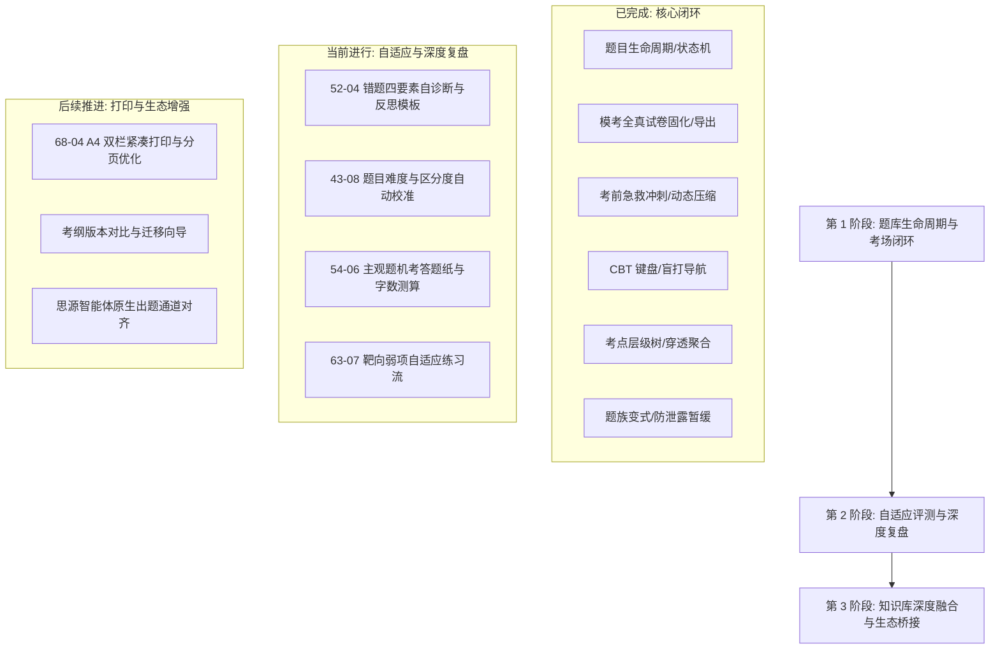

# 自适应测评与高阶备考系统竞品调研（2026-10-20）

> 本期调研深入探索高阶计算机自适应测评（CAT / IRT 经典测验理论与项目反应理论）、国内头部备考题库（粉笔、金考典、华图）以及顶级知识管理工具（SuperMemo 渐进阅读、MarginNote 原书摘录制卡、Logseq 知识图谱）。
> 核心目标：结合小驴考试思源笔记本地优先、离线可用的核心优势，梳理提炼下一阶段的高价值待办事项，制定精密落地的开发计划。

---

## 一、 核心领域竞品深度对比与特性剖析

| 领域 | 代表产品 | 核心先进特性 | 优劣势剖析 | 对小驴考试的落地启示 |
|---|---|---|---|---|
| **自适应测评 (CAT / IRT)** | **GMAT / GRE / 医学执业机考** | 1. 试题参数动态校准（难度 $b$、区分度 $a$） 2. 学习者能力值 $\theta$（Theta）动态估计 3. 终止准则与测量标准误（SEM）收敛 | **优势**：题量少、测得准、防刷题虚高 **劣势**：算法复杂、冷启动需大样本 | **小驴落地设计**： 1. 实现简易 Rasch 模型/经典测量指标（实测难度 $P$ 与区分度 $D$） 2. 依据真实作答流水自动计算区分度，智能检出低区分度无效题目 3. 建立题目实测难度 vs 作者主观难度对比矩阵 |
| **高阶考场仿真与复盘** | **粉笔 App / 金考典** | 1. 主观题字数实时统计与评分参考分步对照 2. 真实考场全真模拟（防误触、全真答题卡） 3. 考后深度失分诊断报告（粗心/时间/知识盲区） | **优势**：贴近中国考试国情、手感极佳 **劣势**：高度云端化、封闭不可导出 | **小驴落地设计**： 1. 主观题实时字数统计与标准作答纸网格渲染 2. 考后失分归因与自诊断备忘（当时怎么想、错在哪里、下次检查点） 3. 错题同源变式（Siblings）防泄露暂缓（已于 65-03 落地） |
| **知识库-题目双向联动** | **MarginNote / SuperMemo** | 1. 原文高亮一键生成题卡，点击双向跳回书页上下文 2. 渐进式提取出题（Incremental Reading/Quizzing） 3. 知识树大纲与题目多级映射 | **优势**：深度打通笔记与记忆、知识留痕清晰 **劣势**：学习门槛高、专业考试题库支持弱 | **小驴落地设计**： 1. 基于思源块 ID/文档 ID 的无缝原位回跳（已支持基础版） 2. 多级考点大纲树（KpTree）向上穿透聚合掌握度（已于 51-01 落地） 3. 增加阅读笔记渐进切片出题与知识点覆盖缺口透视 |
| **科学遗忘与本地记忆** | **Anki / FSRS-5** | 1. 记忆稳定性与可提取性模型（D/S/R） 2. 考前动态压缩（Filtered Deck Cram） 3. 同源卡片暂缓（Bury Siblings） | **优势**：长周期记忆极度高效、完全本地化 **劣势**：缺少成卷模考、缺乏试卷不可变概念 | **小驴落地设计**： 1. 考前急救冲刺与动态间隔压缩引擎（已于 53-04 落地） 2. 模考全真试卷固化与纯享答卷 Markdown 导出（已于 55-07 落地） 3. 错题双保险时效状态机（已于 39-05 落地） |

---

## 二、 提炼形成的增量待办事项（待办梳理与完善）

结合上述调研，将新提炼的 5 大方向、共 10 项增量功能细化梳理如下，纳入备考进阶路线图：

### 1. 【自适应评测与题目质量治理】
- [ ] **43-08 题目实测难度与区分度自动校准（Item Difficulty & Discrimination）**：
  - **背景与痛点**：当前题目的难度系数大多由录入作者主观设定（1–5 星），缺乏真实检验；部分题目选项设计不合理导致尖子生与后进生均选错。
  - **规格设计**：
    - 实测难度 $P = \text{答对人数} / \text{总作答人次}$（0–1，值越低越难）；
    - 实测区分度 $D = P_{\text{高分组}} - P_{\text{低分组}}$（依据历史作答表现前 27% 与后 27% 考生计算）；
    - 自动检出低区分度题（$D < 0.2$）与负区分度异常题（$D < 0$，可能题目有错或答案存在争议）；
    - 在题库健康面板与 Peek 抽屉直观展示。

### 2. 【学习者认知诊断与错题自省】
- [ ] **52-04 错题四要素自诊断短模板（Self-Diagnosis Rationale）**：
  - **背景与痛点**：做错题仅看答案解析无法纠正思维盲区，学习者需要记录“当时怎么想、错在哪里、依据与下次检查点”。
  - **规格设计**：
    - 四要素结构化自诊断：`thought`（当时解题思路与误判点）、`rootCause`（根因：审题粗心/概念模糊/计算失误/题意陷阱/时间紧迫）、`rationale`（书本依据或法规条款）、`checklist`（下次同类题避坑检查点）；
    - 与官方解析物理隔离，支持自诊断历史版本追加，导出时作为复盘附录。

### 3. 【主观论述与申论机考体验】
- [ ] **54-06 主观题机考答题纸与字数实时测算（Subjective Paper Grid）**：
  - **背景与痛点**：申论、法考主观题、考研论述题对作答字数有严格限制（如“不超过 300 字”、“800–1000 字”），普通文本框无法感知版面与字数压力。
  - **规格设计**：
    - 提供“标准方格答题纸”（模拟真实机考 25×N 网格）与“纯文本沉浸框”双模式；
    - 实时统计中文字数、标点数与字符总数，支持最低/最高字数警戒线（绿色合格、黄色接近、红色超限）；
    - 结合已实现的采分点（Rubric Criteria）自评形成完整主观题阅卷流。

### 4. 【备考进度与自适应推题】
- [ ] **63-07 靶向弱项自适应练习流（Targeted Adaptive Session）**：
  - **背景与痛点**：刷题时盲目全库随机容易做大量已掌握的题，用户需要集中攻克薄弱环节。
  - **规格设计**：
    - 结合 51-01 已落地的考点层级树 `masteryScore`，自动筛选掌握度低于 60 分的叶子考点；
    - 自动混合该考点下的高频错题、未见题与同族变式题，生成 10–20 题的小型自适应攻坚专题；
    - 练习完成后即时更新该考点的局部掌握度增量。

### 5. 【数据导出与多端便携】
- [ ] **68-04 答卷与解析一键导出 PDF 友好版 HTML（Print Sheet Pro）**：
  - **背景与痛点**：线下打印备考需要极为规范的排版，不能出现跨页断题、材料与小题分离。
  - **规格设计**：
    - 强化 A4 纵向打印 CSS，实现双栏紧凑排版（双栏题册，节约纸张）；
    - 强制共用材料与旗下首道小题同页分页保护（`break-inside: avoid`）；
    - 页眉页脚显示试卷编号、考点大纲范围与生成时间。

---

## 三、 全局开发计划与路线安排

---

## 四、 下阶段自主执行计划排期

根据思源插件自驱推进规范，后续自主开发任务将按以下顺序驱动执行：
1. **第一优先级（立即推进）**：**52-04 错题四要素自诊断短模板与反思备忘引擎（`src/core/selfDiagnosis.ts`）**；
2. **第二优先级**：**43-08 题目实测难度与区分度自动校准引擎（`src/core/itemDiscrimination.ts`）**；
3. **第三优先级**：**54-06 主观题机考答题纸网格与字数实时测算引擎（`src/core/wordCount.ts`）**；
4. **第四优先级**：**63-07 靶向弱项自适应攻坚专题组卷引擎**。
